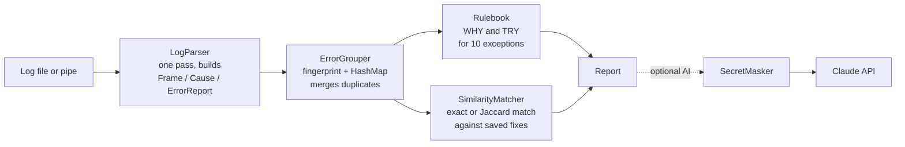

# TraceLens

**A Java command-line tool that turns a long crash log into the real cause of the error, points to your own failing line of code, and remembers how you fixed similar errors before.**

Plain Java 17 · Maven · JUnit 5 · no frameworks · 129 tests · optional Claude AI explanation

---

## The problem

When a Java app crashes, you get hundreds of lines of stack trace:

- The **real reason** is buried at the bottom, in the last `Caused by:` line.
- **Your own code** is hidden between dozens of framework lines (`org.hibernate...`, `java.base/...`).
- The **same error repeats** many times, so the log looks worse than it is.
- Weeks later the error comes back and you **don't remember how you fixed it**.
- Pasting the whole log into an AI chat is too long, and can **leak passwords and database addresses**.

## What TraceLens does

```
> tracelens analyze samples/mixed.log

TraceLens 0.4.0 - analyzed mixed.log (39 lines)
Found 6 errors (3 unique).

ERROR #E1  (occurred 3 times, 2026-11-12 09:05:13 -> 2026-11-12 09:31:18)
  ROOT CAUSE  java.lang.NumberFormatException: For input string: "2a"
  YOUR CODE   CartService.java:58  parseQuantity()
              CartController.java:33  addItem()
  WHY         Some text could not be turned into a number.
  TRY         1. Look at the input in the message: empty, spaces or letters?
              2. Use trim() and validate the text before Integer.parseInt
              3. Catch the exception and show the user a clear message

ERROR #E2  (occurred 2 times, 2026-11-12 09:07:40 -> 2026-11-12 09:20:55)
  ROOT CAUSE  java.lang.NullPointerException: Cannot invoke "com.shop.model.User.getEmail()" because "user" is null
  YOUR CODE   UserService.java:42  getUserEmail()
  ...
```

### It remembers your fixes

Save what fixed an error once:

```
> tracelens analyze samples/db-error.log
> tracelens solve E1 "MySQL service was stopped. Fix: net start mysql80"
Saved as S1 for E1 (java.sql.SQLException: Communications link failure - Connection refused).
```

Weeks later, a **similar** error appears in a different file with a different message, and TraceLens shows your own fix first:

```
> tracelens analyze samples/db-error-later.log

ERROR #E1  (occurred once, at 2026-11-27 09:00:00)
  ROOT CAUSE  java.sql.SQLException: Communications link failure - Connection timed out
  YOUR CODE   ProductRepo.java:22  findAll()
              ProductController.java:17  list()
  SOLVED BEFORE
    S1  67% similar - worked 1 time - saved 2026-11-25
        MySQL service was stopped. Fix: net start mysql80
    Did it work?  tracelens feedback S1 yes   (or no)
  WHY         Your app cannot reach the database server.
  TRY         1. Check the database is running ...

> tracelens feedback S1 yes
Great! S1 has now worked 2 times. It will rank higher.
```

## Features

| Feature | What you get |
|---|---|
| **Root cause** | The deepest `Caused by:` and the full chain, e.g. `IllegalStateException -> JDBCConnectionException -> SQLException` |
| **Your code** | Your own lines only; Java and library frames are skipped (or set `--package com.yourapp`) |
| **Duplicates grouped** | 37 copies of one error become one entry: "occurred 37 times", with first and last time |
| **Rulebook** | Plain-English WHY and numbered TRY steps for 10 common exceptions (NPE, database connection, port in use, NumberFormat, ClassNotFound...) |
| **Solved-before memory** | Your fixes are saved and suggested for the same error, or a similar one; ranked by how often they worked |
| **Team sharing** | Fixes live in `.tracelens/solutions.txt`, a plain text file you can commit so your whole team shares them |
| **Optional AI** | `--ai` asks Claude to explain the error; passwords, keys and URLs are masked first; works fully without it |

## Quick start

Needs **Java 17 or newer**. Maven is **not** needed: the Maven wrapper downloads it.

```bash
git clone https://github.com/Malatesh0811/tracelens.git
cd tracelens

./mvnw package          # Windows: .\mvnw.cmd package   (builds and runs all tests)
java -jar target/tracelens.jar analyze samples/mixed.log
```

To type `tracelens` instead of `java -jar target/tracelens.jar`, add a shortcut:

```bash
# Linux / macOS (bash or zsh)
alias tracelens='java -jar /path/to/tracelens/target/tracelens.jar'
```
```powershell
# Windows PowerShell
function tracelens { java -jar C:\path\to\tracelens\target\tracelens.jar @args }
```

## Commands

| Command | What it does |
|---|---|
| `tracelens analyze <logfile>` | Explains every error in the log |
| `tracelens analyze <logfile> --package com.shop` | Only classes in `com.shop` count as your code |
| `mvn test \| tracelens analyze -` | Reads piped output instead of a file |
| `tracelens analyze <logfile> --ai` | Also asks AI for an explanation (needs `ANTHROPIC_API_KEY`) |
| `tracelens solve E1 "what you did"` | Saves your fix for error E1 of the last analysis |
| `tracelens feedback S1 yes` (or `no`) | Did a suggested fix work? Changes its ranking |
| `tracelens history` | Lists all saved fixes, most trusted first |

## How it works



1. **Parse**: `LogParser` reads the log once (O(n)) and recognises exception headers, `Caused by:` lines and `at ...` frames. The deepest cause is the root cause.
2. **Group**: each error gets a **fingerprint**: the exception type, plus the message with numbers and quoted values removed, plus your class and method. A `HashMap` from fingerprint to group finds duplicates in O(1). Groups are sorted most frequent first.
3. **Explain**: a `Rule` interface with three implementations covers 10 common exceptions. The `Rulebook` returns the first rule that matches.
4. **Remember**: a saved fix is suggested when the fingerprint is the same (exact match), or when the exception type is the same and the messages share at least **60% of their words** (Jaccard similarity on `HashSet`s). Suggestions are sorted by similarity, then by worked minus failed.
5. **AI (optional)**: only the extracted facts are sent, never the whole log. A masker hides passwords, tokens, API keys, URL credentials, JDBC URLs and emails first.

## Project structure

```
src/main/java/com/tracelens/
├── Main.java               commands: analyze, solve, feedback, history
├── ReportFormatter.java    builds the text output
├── parser/                 LogParser, ErrorReport, Cause, Frame
├── analysis/               Fingerprint, ErrorGrouper, ErrorGroup
├── rules/                  Rule, SimpleRule, DatabaseConnectionRule, PortInUseRule, Rulebook
├── memory/                 SolutionStore, SimilarityMatcher, Solution, Suggestion, LastAnalysis
└── ai/                     LlmClient, ClaudeClient, AiExplainer, SecretMasker, Json
samples/                    example crash logs to try
```

## Design decisions

- **No frameworks.** It's a command-line tool, so Spring would add weight with no benefit. The only dependency is JUnit 5, for tests.
- **Immutable data.** `Frame`, `Cause` and `ErrorReport` are records with defensive copies, so parsed data can't be changed by accident.
- **Polymorphism where logic differs.** Eight rules differ only in their text, so one `SimpleRule` class covers them. The database and port rules need their own matching logic, so they are their own classes.
- **Plain-text storage.** `solutions.txt` is tab-separated text. It needs no database, people can read it, and it's easy to share through git.
- **AI behind an interface.** `LlmClient` has one method. The real `ClaudeClient` uses Java's built-in `HttpClient` and a small JSON parser, so the AI part adds no library. Tests use a fake.
- **Fails softly.** Without an API key, or when the AI call fails, the analysis is still printed and the command still succeeds.

## Testing

```bash
./mvnw test             # Windows: .\mvnw.cmd test
```

**129 JUnit 5 tests**, including:

- Parser edge cases: `... 80 more` lines, `Native Method` frames, logs with no timestamps, and the invisible BOM character that PowerShell pipes add (a real bug found by running the tool).
- Fingerprints and grouping: different inputs and ids still group together; a different method does not.
- A parameterized test for every built-in rule.
- Similarity: "refused" vs "timed out" matches at 67%; NullPointerExceptions on different objects (50%) do not.
- The full story through the real commands: crash → `solve` → similar crash → suggestion → `feedback`.
- Saved fixes survive a restart; a damaged file gives a clear error instead of losing data.
- The real HTTP code runs against a small local HTTP server: it checks the headers and body sent, and how 200, 401 and 529 responses are handled. No internet or API key needed.

## Optional AI explanation

```powershell
$env:ANTHROPIC_API_KEY = "your-key"      # bash: export ANTHROPIC_API_KEY="your-key"
java -jar target/tracelens.jar analyze samples/db-error.log --ai
```

- Explains up to 3 errors per run, using the root cause, your code lines and your saved fixes.
- Secrets are masked before sending, and the output says how many were hidden.
- Uses the `claude-opus-5-5` model through the Anthropic Messages API.

## Roadmap

- Run the tests automatically on every push with GitHub Actions, and add a coverage report
- Retry the AI call with backoff on rate limits and busy errors
- Watch mode: follow a running app's log and alert on error spikes
